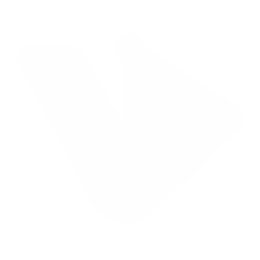

# VDODesk 1.4.0 beta 1

VDODesk is a local-first video editor built with the existing project architecture: a browser UI, a Python standard-library server, and FFmpeg/FFprobe for authoritative media processing. It listens only on `127.0.0.1`, has no account or analytics, and never modifies imported source files.

## Start on Windows 10 or 11

1. Extract the ZIP to a writable folder; do not run it inside the ZIP preview.
2. Double-click `SETUP_WINDOWS.bat` once to install or confirm Python 3.12 and FFmpeg using Windows Package Manager.
3. Close the setup window so Windows refreshes `PATH`.
4. Double-click `START_WINDOWS.bat`. VDODesk opens at <http://127.0.0.1:8765>.

The launcher detects a project `.venv`, the Windows `py` launcher, or `python.exe`; validates Python 3.10+, FFmpeg and FFprobe; supports paths containing spaces; passes options such as `--port`; and keeps error messages visible. See [`docs/WINDOWS.md`](docs/WINDOWS.md) for manual setup and troubleshooting. Optional OpenCV support is installed with `INSTALL_ADVANCED_WINDOWS.bat`.

## Start on macOS (including M4)

1. Install Python 3.10+ and FFmpeg with Homebrew: `brew install python ffmpeg`.
2. Extract the release into a writable folder.
3. Run `./START_MAC.command`, or double-click it if macOS permits.
4. VDODesk opens at <http://127.0.0.1:8765>.

For automatic subject detection, multi-sample tracking, and segmentation masks, run `./INSTALL_ADVANCED_MAC.command` once. This creates a private `.venv` and installs OpenCV. Manual boxes, smart reframe, outlines, and anchored text remain usable without OpenCV.

## Implemented editor features

- Magnetic V1 timeline with numbered video sequencing and direct drag-and-drop reordering; V2/V3 clips can be dragged freely in time or moved between video tracks. Includes visible drop targets, frame snapping, edge auto-scroll, Earlier/Later controls, independent A1 audio and voiceover lanes, edge trimming, split, duplicate, freeze frame, undo/redo, scrubbing and frame-step.
- Cross dissolve, fade, wipe, slide and zoom transitions with adjustable duration.
- Crop, overlay positioning/scaling, rotation, zoom, mirror, opacity, stabilization and focal-point controls.
- Brightness, contrast, saturation, gamma, temperature, tint, hue, shadows/highlights and `.cube` 3D LUT support.
- Ten selected-clip filter presets with adjustable intensity: None, Cinematic, Warm, Cool, Vintage, Mono, Noir, Vivid, Soft and Teal & Orange. Filters affect the live preview, preview renders and exports.
- A dedicated S1 sticker layer with built-in emoji, imported PNG/JPEG/WebP stickers, timeline drag and edge trim, viewer drag placement, scale, rotation, opacity, project persistence and final FFmpeg compositing. Emoji are converted to portable transparent PNG assets with the computer's native color emoji artwork.
- Linear end keyframes for zoom, focal position, color controls and audio gain.
- Subject detection, multi-sample template tracking, GrabCut segmentation mask with manual correction, smart reframing, tracked outline and anchored text. OpenCV activates automated analysis; manual fallback is always available.
- Opening title, text watermark, draggable image watermark, safe-area guides and all five planned aspect-ratio presets.
- Reliable text export across FFmpeg builds: VDODesk uses `drawtext` or libass when available, then falls back to its own transparent-image renderer. Opening titles, text watermarks and tracked labels are therefore exported even by minimal Homebrew FFmpeg builds.
- Per-clip 0–400% audio gain/mute with animated end level, source audio retention, one-click audio/video unlinking, independent A1 drag/trim/delete, selected-music replacement, synchronized A1 timeline playback, adjustable/removable browser-microphone voiceovers and automatic sidechain ducking.
- Audio waveforms, most-recent ten files, automatic browser-compatible H.264 preview proxies for HEVC/MOV and other unsupported media, low-resolution background proxies for large media, and browser/GPU-assisted playback.
- Background preview/export jobs, autosave and crash recovery (including a previous-project snapshot), complete workspace asset rediscovery/relinking, JSON project save/open.
- MP4, MOV and WebM containers; H.264, H.265/HEVC and VP9; custom dimensions and quality; Apple VideoToolbox hardware encoding when available with software fallback.

## Workflow

Import media → use `+` to add clips → arrange and trim the timeline → edit the selected clip in the Inspector → use **Render preview** for full compositing → **Export**. To add stickers, open **Stickers**, choose an emoji or highlight an imported image and add it to S1; then drag the S1 item in time, trim its edges, or drag it directly in the viewer. To replace sound, select a video clip, open **Audio**, choose **Unlink audio to A1**, highlight an imported music file, then choose **Replace with highlighted music**. The A1 item can be moved, trimmed, muted, or deleted without affecting the video, and the normal timeline Play button auditions it in sync. Outputs are also retained in `projects/exports/`.

The live browser preview is designed for responsive editing and visibly approximates every color control, crop, keyframes, transforms and animated audio level. **Render preview** and final export use the same FFmpeg project renderer and are the parity reference. VDODesk detects formats the browser cannot decode—commonly HEVC camera footage in `.mov` files—and automatically creates an H.264/AAC proxy, switches the selected clip to it, and retries playback. Large files also receive a lower-resolution proxy in the background.

## Projects and recovery

- Autosave is kept in the browser's local storage after each edit. Use Inspector → Project → Restore last autosave after a browser or process interruption. Starting a new project also preserves one previous-project recovery snapshot.
- Downloaded `.vdodesk.json` files are portable manifests. Media is stored under `projects/media/`; the editor rediscovers every workspace asset at startup, including items outside Recent 10. Use **Relink selected** if a reference needs replacement.
- The ten most recent imports are stored in `projects/recent-files.json` and survive **New project**.

## Keyboard controls

- Space: play/pause
- Left/Right: one output frame
- Home/End: timeline start/end
- `[` / `]`: selected clip start/end
- Delete/Backspace: delete the selected video or independent A1 audio item
- Command/Ctrl+Z and Command/Ctrl+Shift+Z: undo/redo

## Validation and limitations

Run `python3 -m unittest discover -s tests -v` (or `py -3 -m unittest discover -s tests -v` on Windows) to exercise workspace persistence, waveforms, proxies, freeze frames, tracking fallbacks, clip filters, color/effect rendering, timed sticker compositing, audio gain/mute, detached A1 replacement, transitions, overlays, titles, watermarks, voiceover ducking and export compatibility. VDODesk is a feature-complete beta, not a signed Windows installer or notarized macOS application. Very large/high-resolution projects remain bounded by local RAM, storage and FFmpeg performance. Stabilization is FFmpeg `deshake`; tracking uses efficient sampled template tracking rather than a cloud AI service. Test short exports before committing important footage.

Distribution requires an independent review of FFmpeg codec/patent licensing, third-party component licenses, security hardening and Apple notarization requirements.
